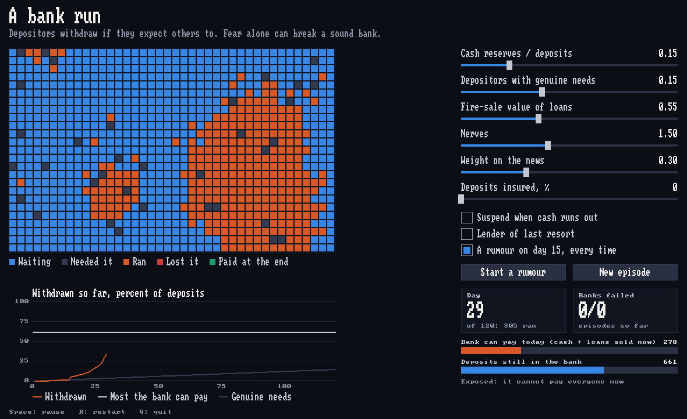
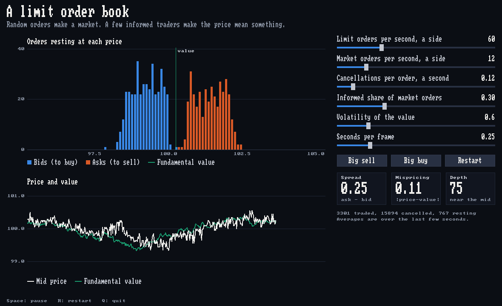

# econ-sims — economics you can watch

Four models from the economics curriculum, each as a small simulation with
sliders. Every one is a single file of C17 on SDL2: it builds as a native
program and, from the same source, as a WebAssembly page.

**[Run them in the browser](https://micomrkaic.github.io/econ-sims/)**

| | |
|---|---|
|  |  |
| **Schelling's segregation model.** Agents move when too few neighbours are like them. | **Wealth when income is risky.** Households save against job loss; inequality from luck alone. |
|  |  |
| **A bank run.** A rumour, a queue, and a solvent bank that fails anyway. | **A limit order book.** Random orders make a market; informed ones make the price mean something. |

## The models

### Schelling's segregation model (`src/schelling.c`)

Two groups on a 76 x 76 grid with some empty cells. An agent is content if at
least a chosen share of its neighbours belong to its own group; a discontent
agent moves to an empty cell where it would be content. With the default
wish for 35% like neighbours, the city settles at about 77%.

Sliders: like neighbours wanted, empty cells, group shares, neighbourhood
radius, speed.

### Wealth when income is risky (`src/wealth.c`)

The incomplete-markets household of Bewley, Huggett and Aiyagari. Income is a
wage when employed, a benefit when not, and a multiple of the wage in an
occasional high-pay spell; the household moves between the three at random
and cannot insure. It saves or borrows at a fixed interest rate, down to a
borrowing limit, to maximise expected CRRA utility. The consumption rule is
solved by the endogenous grid method (Carroll 2006) each time a slider moves,
and 20,000 households then follow it. The window shows their wealth as a
histogram and a Lorenz curve, the Gini coefficient, and the consumption rule
itself. A period is a year; wealth is in years of wages.

This is the household side only: the interest rate is a slider, not a market
price.

Sliders: interest rate, patience, risk aversion, borrowing limit, chance of
job loss, unemployment benefit, high pay (set it to 1 for the two-state
textbook model).

### A bank run (`src/bankrun.c`)

After Diamond and Dybvig (1983). A bank takes deposits from 1,000 people,
keeps a share as cash and lends the rest; loans repay 1.25 at the end of 120
days, or only their fire-sale value before. Some depositors genuinely need
their money on a random day. The others watch their neighbours and the news,
project total withdrawals, and withdraw if the projection exceeds what the
bank could pay before its loans mature. The bank pays first come, first
served, so the fear confirms itself.

Sliders and switches: cash reserves, genuine needs, fire-sale value, nerves,
weight on the news, share of deposits insured, suspension of withdrawals,
lender of last resort, and a rumour button.

The depositors' rule is a stated behavioural rule that captures the logic of
the model's run equilibrium; it is not derived as an equilibrium strategy.

### A limit order book (`src/orderbook.c`)

The zero-intelligence market of Daniels, Farmer and co-authors (2003). Limit
orders arrive at random prices within a window of the opposite best price,
each resting order is cancelled at a constant rate, and market orders trade
at once against the best price. The asset also has a fundamental value that
follows a random walk, and a share of market orders comes from traders who
know it. The window shows the quantity resting at each price and the mid
price against the value.

Sliders: limit order rate, market order rate, cancellation rate, informed
share, volatility of the value, speed; buttons for a large sell or buy order.

## Build

Native, with SDL2:

    # Debian/Ubuntu: sudo apt install build-essential libsdl2-dev
    # macOS:         brew install sdl2
    make
    ./build/schelling        # or wealth, bankrun, orderbook

In the window: drag the sliders; Space pauses, R restarts, Q quits.

Browser, with Emscripten:

    make web                 # writes docs/*.html, .js, .wasm
    python3 -m http.server -d docs

## Tests

    make test

Each program has model checks that run without a window (`--test`), then a
30-frame run on SDL's dummy video driver to exercise the drawing code.

- **schelling** (8 checks): zero tolerance moves nobody; a shuffled city is
  half like-neighbours; 35% wanted gives over 70%; groups and vacancies are
  conserved; a higher threshold segregates more; a seed reproduces a city.
- **wealth** (15): the budget holds exactly; consumption rises with wealth
  and income; the Euler equation holds off the borrowing limit; with no risk,
  consumption growth equals the closed form `(beta (1 + r))^(1/sigma)`; a
  higher rate raises saving, a looser limit lowers net wealth, more job risk
  lowers consumption at every wealth level; the employment shares settle at
  the Markov chain's stationary ones.
- **bankrun** (15): a sound bank sees only genuine withdrawals and pays those
  who wait more than they put in; the books balance; a rumour does not break
  a sound bank but breaks a thin one that is nonetheless solvent; insurance,
  suspension and a lender of last resort each stop the run.
- **orderbook** (15): the book never crosses or goes negative; a spread
  emerges; fewer limit orders or more market orders widen it; informed
  traders cut the gap between price and value by more than half; a large
  order moves the price and the book recovers; re-centring the price grid
  leaves the price where it was.

## Layout

    src/ui.h         the shared kit: window, bitmap font, sliders, buttons, tiles, plots
    src/rng.h        a small seedable random number generator
    src/font8x8.h    public-domain 8x8 bitmap font
    src/*.c          one file per simulation: the model, its checks, its window
    web/shell.html   the page each browser build is poured into
    docs/            the browser builds and landing page (GitHub Pages serves this folder)

To serve the browser versions from GitHub Pages: Settings, Pages, deploy from
the `main` branch, folder `/docs`.

## Licence

GPL-3.0-or-later; see `LICENSE`. The font is public domain (Daniel Hepper's
font8x8).
