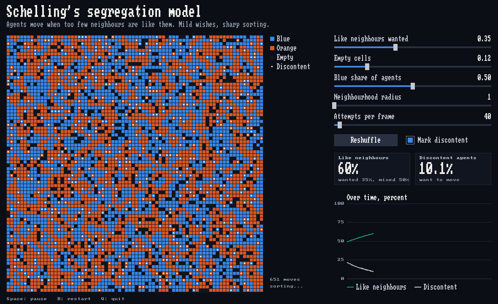
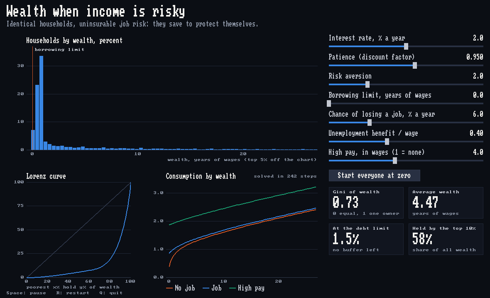
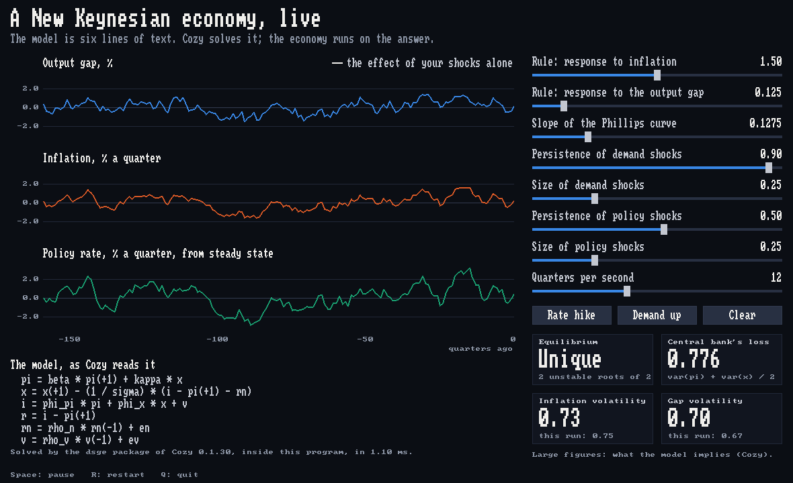
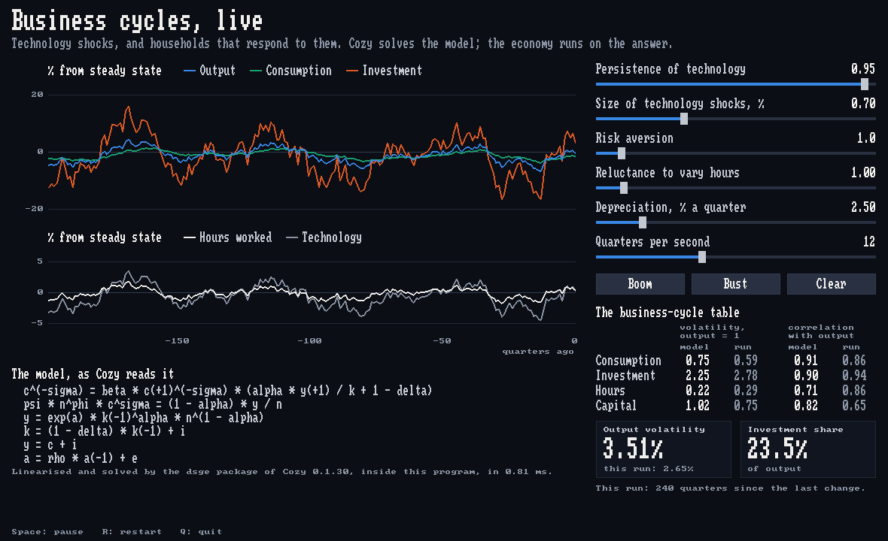
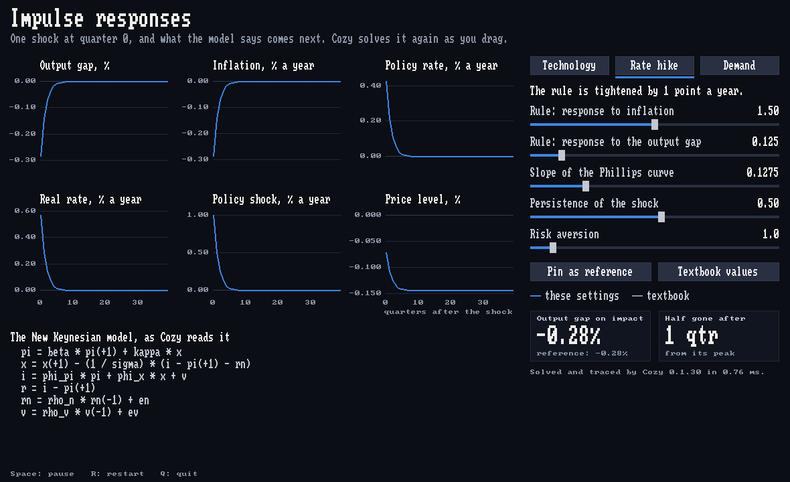

# econ-sims — economics you can watch

Seven models from the economics curriculum, each as a small simulation with
sliders. Every one is a single file of C17 on SDL2: it builds as a native
program and, from the same source, as a WebAssembly page.

Four are models of people and markets, simulated agent by agent. Three are
macro models, and those do not solve their equations in C: they hand the
model, as text, to [Cozy](https://github.com/micomrkaic/cozy), a matrix
language whose interpreter is linked into the program, and run on what its
`dsge` package returns.

**[Run them in the browser](https://micomrkaic.github.io/econ-sims/)**

| | |
|---|---|
|  |  |
| **Schelling's segregation model.** Agents move when too few neighbours are like them. | **Wealth when income is risky.** Households save against job loss; inequality from luck alone. |
|  |  |
| **A bank run.** A rumour, a queue, and a solvent bank that fails anyway. | **A limit order book.** Random orders make a market; informed ones make the price mean something. |
|  |  |
| **A New Keynesian economy.** A policy rule, sticky prices and shocks; solved live by Cozy. | **Business cycles.** Technology shocks and the table of volatilities they imply; solved live by Cozy. |
|  | |
| **Impulse responses.** One shock, forty quarters, six variables, against a pinned reference. | |

## The models

### Schelling's segregation model (`src/schelling.c`)

Two groups on a 76 x 76 grid with some empty cells. An agent is content if at
least a chosen share of its neighbours belong to its own group; a discontent
agent moves to an empty cell where it would be content. With the default
wish for 35% like neighbours, the city settles at about 77%.

Sliders: like neighbours wanted, empty cells, group shares, neighbourhood
radius, speed.

### Wealth when income is risky (`src/wealth.c`)

The incomplete-markets household of Bewley, Huggett and Aiyagari. Income is a
wage when employed, a benefit when not, and a multiple of the wage in an
occasional high-pay spell; the household moves between the three at random
and cannot insure. It saves or borrows at a fixed interest rate, down to a
borrowing limit, to maximise expected CRRA utility. The consumption rule is
solved by the endogenous grid method (Carroll 2006) each time a slider moves,
and 20,000 households then follow it. The window shows their wealth as a
histogram and a Lorenz curve, the Gini coefficient, and the consumption rule
itself. A period is a year; wealth is in years of wages.

This is the household side only: the interest rate is a slider, not a market
price.

Sliders: interest rate, patience, risk aversion, borrowing limit, chance of
job loss, unemployment benefit, high pay (set it to 1 for the two-state
textbook model).

### A bank run (`src/bankrun.c`)

After Diamond and Dybvig (1983). A bank takes deposits from 1,000 people,
keeps a share as cash and lends the rest; loans repay 1.25 at the end of 120
days, or only their fire-sale value before. Some depositors genuinely need
their money on a random day. The others watch their neighbours and the news,
project total withdrawals, and withdraw if the projection exceeds what the
bank could pay before its loans mature. The bank pays first come, first
served, so the fear confirms itself.

Sliders and switches: cash reserves, genuine needs, fire-sale value, nerves,
weight on the news, share of deposits insured, suspension of withdrawals,
lender of last resort, and a rumour button.

The depositors' rule is a stated behavioural rule that captures the logic of
the model's run equilibrium; it is not derived as an equilibrium strategy.

### A limit order book (`src/orderbook.c`)

The zero-intelligence market of Daniels, Farmer and co-authors (2003). Limit
orders arrive at random prices within a window of the opposite best price,
each resting order is cancelled at a constant rate, and market orders trade
at once against the best price. The asset also has a fundamental value that
follows a random walk, and a share of market orders comes from traders who
know it. The window shows the quantity resting at each price and the mid
price against the value.

Sliders: limit order rate, market order rate, cancellation rate, informed
share, volatility of the value, speed; buttons for a large sell or buy order.

## The macro models, solved by Cozy

The three programs below share two models, kept as text in `src/models.h`
in the notation of Dynare: `x(+1)` is next quarter's `x` as expected today,
`x(-1)` last quarter's. This is the whole of the New Keynesian model:

    pi = beta * pi(+1) + kappa * x
    x = x(+1) - (1 / sigma) * (i - pi(+1) - rn)
    i = phi_pi * pi + phi_x * x + v
    r = i - pi(+1)
    rn = rho_n * rn(-1) + en
    v = rho_v * v(-1) + ev

Each program starts a Cozy interpreter (`cozy_open`), loads Cozy's `dsge`
package from text carried in the binary, and passes it the model. When a
slider moves, `dsge.solve` linearises the model around its steady state with
exact derivatives, checks the Blanchard-Kahn conditions and returns the
decision rule `y = P y(-1) + Q e`; the C side reads `P` and `Q` as arrays of
doubles (`cozy_matrix`) and steps and draws the economy with them. A solve
takes about a millisecond, natively and in the browser. `src/macro.h` is the
whole bridge, about 80 lines. The equations drawn in each window are the
strings that were passed to Cozy.

Cozy is vendored in `third_party/cozy` (the interpreter's core, its embedding
API and the `dsge` package; version and commit in `third_party/cozy/VERSION`)
and refreshed from a Cozy checkout with `tools/update-cozy.sh`.

### A New Keynesian economy (`src/nk.c`)

The three-equation model of Gali (2015, ch. 3): a Phillips curve, an IS
curve and an interest-rate rule, with a persistent demand disturbance (the
natural rate of interest) and a policy disturbance. The economy runs a
quarter at a time with fresh shocks, and the window plots the output gap,
inflation and the policy rate, with the volatilities the model implies
beside those of the run. Lower the rule's response to inflation below the
Taylor principle's threshold and Cozy reports that the equilibrium is no
longer unique; the economy stops.

Sliders: the rule's responses to inflation and to the gap, the slope of the
Phillips curve, the persistence and size of demand and of policy shocks,
speed; buttons for a rate hike and a demand shock. A press is marked on the
charts, and a white line traces what your shocks alone have done (the model
is linear, so their effect simply adds to everything else).

### Business cycles (`src/cycles.c`)

The real business cycle model with a choice of hours: households consume,
save and work, firms rent capital and labour, and technology follows an
AR(1). Its steady state has a closed form, supplied as a Cozy function that
the package verifies. The window plots output, consumption, investment,
hours and technology in percent from the steady state, and keeps the
business-cycle table: each series' volatility relative to output and its
correlation with output, as the model implies (`dsge.moments`) and as the
run has turned out.

Sliders: persistence and size of technology shocks, risk aversion, the
inverse elasticity of labour supply, depreciation, speed; buttons for a boom
and a bust (a technology shock of four standard deviations, marked on the
charts).

### Impulse responses (`src/irf.c`)

Three experiments on those two models: a rise in technology, a monetary
tightening and a rise in demand. Cozy traces forty quarters after the shock
(`dsge.irf`) each time a slider moves, and the window draws six small plots
against a reference path: the textbook calibration, or any setting you pin.

## Build

Native, with SDL2:

    # Debian/Ubuntu: sudo apt install build-essential libsdl2-dev
    # macOS:         brew install sdl2
    make
    ./build/schelling        # or wealth, bankrun, orderbook, nk, cycles, irf

The macro programs compile the vendored Cozy, which is written in C23 and
needs a compiler that has it: gcc 13 or clang 16, or later.

In the window: drag the sliders; Space pauses, R restarts, Q quits.

Browser, with Emscripten:

    make web                 # writes docs/*.html, .js, .wasm
    python3 -m http.server -d docs

## Tests

    make test

Each program has model checks that run without a window (`--test`), then a
30-frame run on SDL's dummy video driver to exercise the drawing code.

- **schelling** (8 checks): zero tolerance moves nobody; a shuffled city is
  half like-neighbours; 35% wanted gives over 70%; groups and vacancies are
  conserved; a higher threshold segregates more; a seed reproduces a city.
- **wealth** (15): the budget holds exactly; consumption rises with wealth
  and income; the Euler equation holds off the borrowing limit; with no risk,
  consumption growth equals the closed form `(beta (1 + r))^(1/sigma)`; a
  higher rate raises saving, a looser limit lowers net wealth, more job risk
  lowers consumption at every wealth level; the employment shares settle at
  the Markov chain's stationary ones.
- **bankrun** (15): a sound bank sees only genuine withdrawals and pays those
  who wait more than they put in; the books balance; a rumour does not break
  a sound bank but breaks a thin one that is nonetheless solvent; insurance,
  suspension and a lender of last resort each stop the run.
- **orderbook** (15): the book never crosses or goes negative; a spread
  emerges; fewer limit orders or more market orders widen it; informed
  traders cut the gap between price and value by more than half; a large
  order moves the price and the book recovers; re-centring the price grid
  leaves the price where it was.
- **nk** (13): what Cozy returns is Gali's closed form to ten decimals; the
  economy stepped in C has the standard deviations Cozy computes; determinacy
  switches exactly where `kappa (phi_pi - 1) + (1 - beta) phi_x` changes
  sign; a tougher rule lowers the volatility of inflation; a rate hike adds
  exactly its own impulse response to whatever else is happening; a Cozy
  error arrives as a message.
- **cycles** (14): the steady state has the ratios the algebra gives; the
  decision rule satisfies the resource constraint, the production function
  and capital accumulation; only capital and technology carry history;
  consumption is smoother than output and investment over twice as volatile;
  a million simulated quarters match the theoretical volatilities and
  correlations; the model solves at every corner of the sliders' ranges.
- **irf** (16): the traced path is the decision rule applied forty times;
  capital responds with a hump; a tightening moves the gap and inflation by
  the closed form's amounts, fades at the shock's persistence and leaves the
  price level permanently lower; the real rate is the policy rate less
  expected inflation; a rule that violates the Taylor principle has no
  unique response.

## Layout

    src/ui.h         the shared kit: window, bitmap font, sliders, buttons, tiles, plots
    src/rng.h        a small seedable random number generator
    src/font8x8.h    public-domain 8x8 bitmap font
    src/*.c          one file per simulation: the model, its checks, its window
    src/macro.h      the bridge to Cozy: start it, run source, read matrices back
    src/models.h     the two macro models, as text
    third_party/cozy the Cozy interpreter and its dsge package (vendored, unedited)
    tools/           update-cozy.sh refreshes the vendored copy; txt2c puts a text file in a C array
    web/shell.html   the page each browser build is poured into
    docs/            the browser builds and landing page (GitHub Pages serves this folder)

To serve the browser versions from GitHub Pages: Settings, Pages, deploy from
the `main` branch, folder `/docs`.

## Licence

GPL-3.0-or-later; see `LICENSE`. Cozy, in `third_party/cozy`, is by the same
author under the same licence. The font is public domain (Daniel Hepper's
font8x8).
